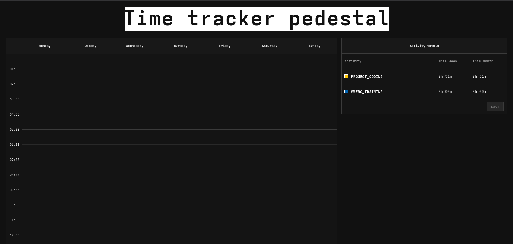

<br />
<div align="center">
  <a href="https://github.com/ThorTuwy/WallaReq">
    
  </a>

  <p align="center">
    Embeded website of the <a href="https://github.com/ThorTuwy/time-tracker-pedestal">time-tracker-pedestal</a> project.
  </p>
  
  
  <div style="text-align: center;">
    
  </div>
</div>

## About The Project
This is the website that is embedded inside [time-tracker-pedestal](https://github.com/ThorTuwy/time-tracker-pedestal), in which you can see your activities and configure the device.
The backend is handle by [time-tracker-pedestal](https://github.com/ThorTuwy/time-tracker-pedestal) project and front-end (this repo) is written in preact.

>[!WARNING]
>This repo is only intended to be use by developers, pls refer to the main repo for more information about the project.

# Developers

## Prerequisites

You only need to have install pnpm.

## Run the project

For installing dependencies:
```sh
pnpm install
```

To run the project:
```sh
pnpm dev
```
## Build the project

>[!WARNING]
>The build of this project, has been made to upload directly into ESP32 fs, so it would request files that only ESP32 webserver provided.
>For that, only use this build to uploaded to ESP32, and not for development.

```sh
pnpm build
```

## TODO

- [ ] Make a settings panel.
- [ ] Smooth corners (Currently a lot of edge-cases are not treated, mainly with weekly calender)

